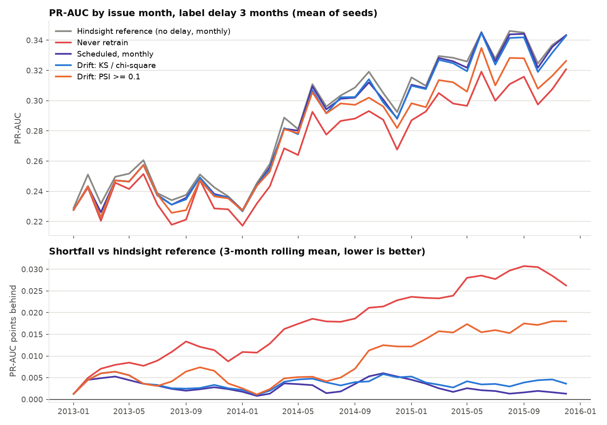

# Drift-aware retraining: an experiment

**Question:** when labels arrive late, does retraining when drift is detected beat retraining on a fixed schedule, and at what cost?

On 36 months of Lending Club loans (2013–2015), replayed month by month with labels arriving 1, 3 or 6 months late, **drift-triggered retraining did not beat a schedule**:

- Never retraining cost **0.015–0.021 PR-AUC** (about 5–7%). Retraining clearly matters.
- **Monthly scheduled retraining was best** in 103 of 105 paired comparisons. Quarterly retraining got within 0.001 of it with 11 retrains instead of 35.
- Per-feature KS tests and a domain classifier **alarmed in about 35 of 36 months**, so drift-triggered retraining turned into a 2-month schedule limited by its cooldown: same quality as quarterly, about 60% more retrains. PSI ≥ 0.1 stayed quiet and kept less than half of the benefit.
- In a controlled benchmark with known drift onsets, input-only tests caught input drift in 0–2 batches but were **blind to concept drift** (no better than chance). A label-based calibration test caught concept drift exactly one label delay late, and its alarms were followed by real harm 89–97% of the time. Input-drift alarms were followed by harm 0% of the time.

Full write-up, figures and caveats: **[docs/EXPERIMENT.md](docs/EXPERIMENT.md)**



```bash
pip install -r requirements-experiments.txt
curl -L -o data/raw/lending_club.csv "https://zenodo.org/api/records/11295916/files/LC_loans_granting_model_dataset.csv/content"
bash experiments/run_all.sh && python -m experiments.make_report
```

### Rules for when a model goes live

Shared by the experiment and the production pipeline below:

- **Promotion gate:** a retrained model is promoted only if it beats the current model on the newest labeled data and doesn't get worse on older held-out data ([src/promotion.py](src/promotion.py)).
- **Noise guard:** a cooldown after each retrain plus a minimum number of newly labeled rows, so the system can't retrain on noise.
- **Rollback:** every candidate is registered in MLflow; `champion` / `previous_champion` aliases make rollback one step: `python rollback.py --model-name bank_marketing_xgboost --restore-serving-files`, then `POST /reload`.

---

# The pipeline

The system the experiment's rules plug into: binary classification on UCI Bank Marketing, with online serving, drift monitoring, and conditional retraining.

## What This System Does

1. Trains and tracks an XGBoost classifier in MLflow.
2. Serves predictions through FastAPI (`/predict`, `/health`, `/metrics`).
3. Monitors data drift with Evidently and stores run summaries.
4. Triggers retraining when drift crosses threshold.
5. Retrains on historical + incoming labeled data, upweighting recent samples.
6. Promotes candidate model only if quality gates pass.

## Architecture

### Core Components
- **Modeling**: `xgboost`, `scikit-learn`
- **Tracking**: `MLflow`
- **Serving**: `FastAPI`
- **Orchestration**: `Apache Airflow`
- **Drift Monitoring**: `Evidently AI`
- **Observability**: `Prometheus`, `Grafana`
- **Storage**: `PostgreSQL`
- **Runtime**: `Docker Compose`
- **Deployment-ready manifests**: `k8s/*.yaml`

### Key Workflows
- **Training**: `train.py` -> logs runs/metrics -> promotes baseline model
- **Monitoring**: `monitor.py` -> drift report HTML + JSON summary + DB entry
- **Retraining**: `retrain.py` -> weighted training + unseen-shift evaluation + gated promotion
- **Automation**: `airflow/dags/daily_monitor_retrain_dag.py`

## Repository Layout

```text
.
├── app.py
├── train.py
├── monitor.py
├── retrain.py
├── rollback.py
├── generate_recession_data.py
├── simulate_traffic.py
├── docker-compose.yml
├── src/
├── experiments/          # drift-vs-schedule experiment (see docs/EXPERIMENT.md)
├── airflow/dags/
├── grafana/
├── prometheus/
├── k8s/
├── tests/
└── docs/
    ├── screenshots/
    └── videos/
```

## Reproducible Run (Local)

### Prerequisites
- Docker + Docker Compose
- Dataset at `data/raw/bank-additional-full.csv`

### Start Services

```bash
cp .env.example .env
docker compose down -v
docker compose up -d --build
```

### Baseline Training

```bash
docker compose exec -T trainer python /app/train.py
```

### Generate Incoming Shifted Data

```bash
docker compose exec -T trainer python /app/generate_recession_data.py \
  --source-path /app/data/raw/bank-additional-full.csv \
  --output-dir /app/data/processed/recession \
  --recent-ratio 0.35 \
  --holdout-ratio 0.2
```

### Simulate Inference Traffic and Drift

```bash
docker compose exec -T trainer python /app/simulate_traffic.py \
  --api-url http://api:8000/predict \
  --phase-seconds 60 \
  --requests-per-second 1 \
  --run-monitor-after-phase
```

### Weighted Retraining + Promotion Decision

```bash
docker compose exec -T trainer python /app/retrain.py \
  --dataset-path /app/data/raw/bank-additional-full.csv \
  --new-data-path /app/data/processed/recession/recession_incoming_full.csv \
  --new-data-holdout-ratio 0.2 \
  --new-data-weight 4.0
```

## Endpoints

- Airflow: `http://localhost:8080`
- Grafana: `http://localhost:3000`
- MLflow: `http://localhost:5001`
- Prometheus: `http://localhost:9090`
- FastAPI: `http://localhost:8000`
- FastAPI OpenAPI: `http://localhost:8000/docs`

## Quality Gates (Promotion Policy)

Retrained candidate is accepted only when:
- It beats the current model's PR-AUC on the newest labeled (shifted) holdout by more than `RETRAIN_IMPROVEMENT_THRESHOLD` (default `0.005`), and
- It does not degrade historical ROC-AUC by more than `DEGRADATION_THRESHOLD` (default `0.03`).

A drift-triggered retrain is skipped (unless `--force`) within `RETRAIN_COOLDOWN_HOURS` (default `48`) of the last promotion, or when fewer than `MIN_NEW_LABELED_ROWS` (default `1000`) new labeled rows are available.

Every candidate is registered as a version of `MLFLOW_REGISTERED_MODEL_NAME`; accepted ones take the `champion` alias and the replaced model keeps `previous_champion`. Roll back with:

```bash
docker compose exec -T trainer python /app/rollback.py --model-name bank_marketing_xgboost --restore-serving-files
curl -X POST http://localhost:8000/reload
```

## Validation

```bash
docker compose exec -T trainer pytest -q
```

## Run Screenshots

- [Docker services up](docs/screenshots/01-docker-services-up.png)
- [Training + health check](docs/screenshots/02-train-and-health-check.png)
- [Shifted data generation](docs/screenshots/03-recession-data-generated.png)
- [Traffic + drift simulation](docs/screenshots/04-simulate-traffic-drift-output.png)
- [Retraining decision](docs/screenshots/05-retrain-decision-output.png)
- [MLflow runs](docs/screenshots/06-mlflow-experiment-runs.png)
- [Airflow DAG success](docs/screenshots/07-airflow-daily-dag-graph-success.png)
- [Evidently drift details](docs/screenshots/08-evidently-drift-report-details.png)

## Kubernetes Readiness

Kubernetes is useful for this project because it enables production-grade deployment patterns: service scaling, rolling updates, self-healing pods, and cleaner multi-service operations.

This repository includes Kubernetes manifests under `k8s/` for key services (API, Airflow, MLflow, PostgreSQL, Prometheus, Grafana).  
For local development and demos, Docker Compose is the primary runtime. For production-style deployment, Kubernetes is the natural next step.
