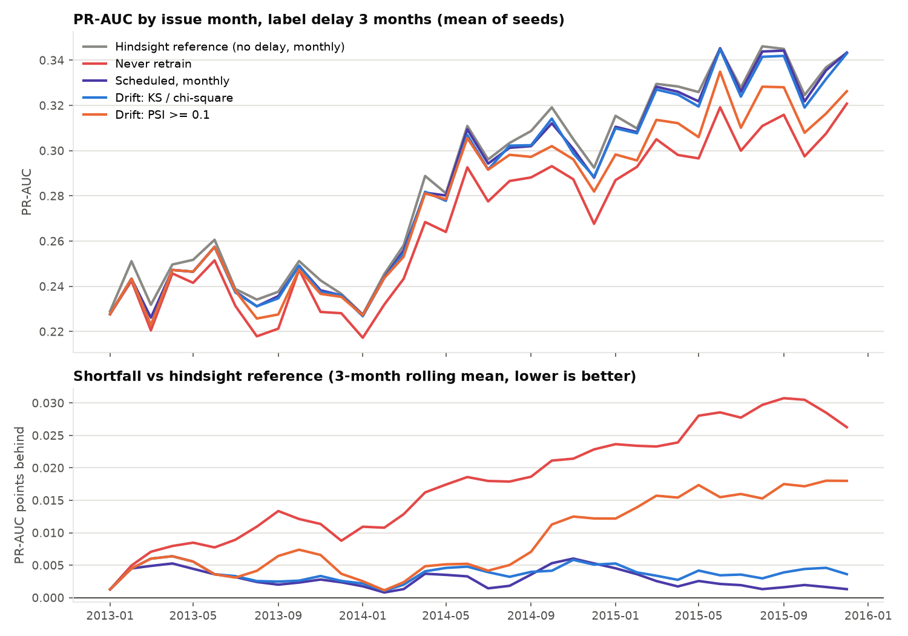
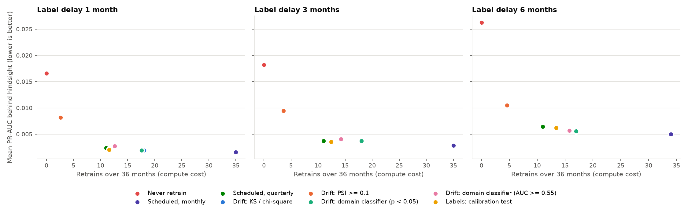
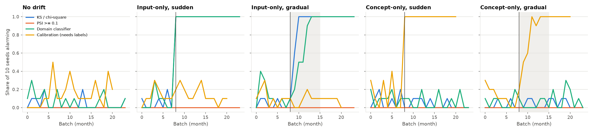
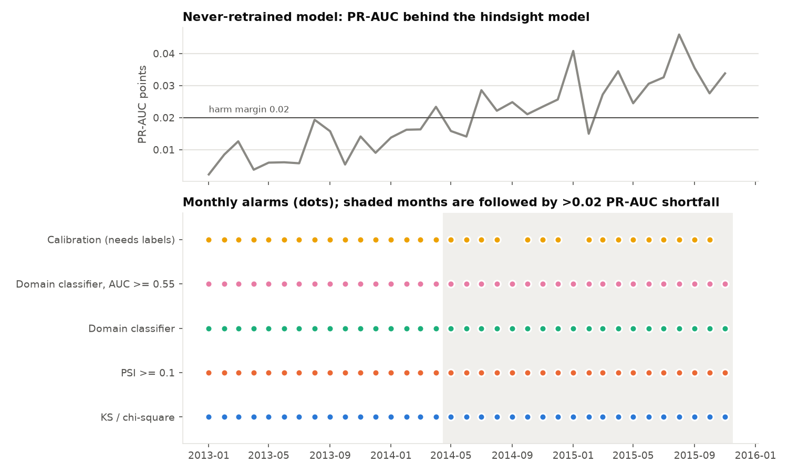

# Does drift-triggered retraining beat a schedule?

**Question.** When labels arrive late, does retraining when drift is detected beat retraining on a fixed schedule, and at what compute cost?

**Answer, on 36 months of Lending Club loans: no.** Retraining at all clearly matters: a model that is never retrained ends up 0.015–0.021 PR-AUC (about 5–7%) behind. Monthly scheduled retraining was the best policy in 103 of 105 paired comparisons (7 other policies × 3 label delays × 5 seeds). Drift-triggered policies matched a *quarterly* schedule at best, and they needed up to 60% more retrains to get there. The input-drift tests alarmed in almost every month, so with a cooldown they behaved like a fixed schedule anyway. The one effect-size rule that stayed quiet (PSI ≥ 0.1) kept less than half of the benefit of retraining.

The controlled benchmark explains why. Input-drift alarms don't predict harm: here, input drift was fully detectable and did not hurt the model. Concept drift did hurt, and only a test that uses labels could see it.

---

## 1. Setup

### Data: real drift, replayed in time order

- **Lending Club accepted loans, 2007–2018** ([Zenodo 11295916](https://zenodo.org/records/11295916), CC-BY-4.0). This is a cleaned version of the Kaggle file. It keeps only fields known at application time and only loans that reached a final state. Target: charged off (1) vs fully paid (0).
- **Features:** annual income, DTI, loan amount, FICO, employment length, purpose, home ownership, state. Free text and zip code are dropped, as are 533 rows with DTI > 100 (one is a 999 sentinel).
- **Window:** the replay covers **Jan 2013 – Dec 2015** (36 months). Over that period mean FICO falls about 20 points, mean DTI rises from about 13 to 19, and the default rate rises from 15% to 20%. That is natural, gradual drift in both inputs and outcomes.
- **Why stop at 2015:** the source keeps only *resolved* loans, as of the end of 2018. Loans issued later are increasingly unresolved, and the resolved ones skew toward early defaults (the 2018 "default rate" is 2–10%). Some 60-month loans from 2014–15 are also unresolved, so the rising default rate in late 2015 is partly this censoring artifact.
- Each month is capped at 8,000 randomly sampled loans (2013–15 volumes grow from about 8k to 38k a month). Drift-test power grows with sample size, so without the cap "more drift" and "more rows" would be confounded.

### Late labels

A loan issued in month *s* gets its label at the end of month *s + d*, where *d* is the label delay. Runs use **d = 1, 3, 6**. In reality the outcome of a 36-month loan takes much longer. Here *d* is a controlled parameter, not a claim about Lending Club.

### What every policy shares

| Piece | Setting |
|---|---|
| Model | XGBoost, fixed hyperparameters (300 trees, depth 4, lr 0.05), so a retrain always costs the same |
| Training data | the trailing 12 *labeled* months; the newest labeled month is held back for the gate |
| Persistent holdout | 15% of every month is never trained on by any model, so the gate's "older data" is unseen by both champion and candidate |
| Promotion gate | candidate must beat the champion's PR-AUC on the newest labeled month **and** lose no more than 0.01 PR-AUC on the older holdout |
| Noise guard | at least 5,000 newly labeled rows since the last retrain; for drift- and label-triggered policies, a **2-month cooldown** after any retrain |
| Seeds | 5 (each re-draws the monthly sample and the holdout) |

### Policies

| Policy | Retrains when |
|---|---|
| Never | never |
| Scheduled, monthly / quarterly | every 1 / 3 months |
| Drift: KS / chi-square | any feature's two-sample test rejects at a family-wise α = 0.05 (Bonferroni), comparing this month's inputs to the champion's training inputs |
| Drift: PSI ≥ 0.1 | any feature's PSI reaches 0.1 |
| Drift: domain classifier (p < 0.05) | a classifier trained to tell training-period rows from this month's rows separates them with significant held-out AUC |
| Drift: domain classifier (AUC ≥ 0.55) | same, but also requires AUC ≥ 0.55 (an effect-size floor) |
| Labels: calibration test | a Hosmer-Lemeshow test rejects the champion's calibration on the **newest labeled** month (it sees labels, so it lags by *d*) |

**Score.** Each month the deployed model is scored on that month's loans, using the true labels in hindsight for reporting only. The *hindsight reference* is a model retrained every month with **zero** label delay. It is not a policy, just a line showing what fresh labels would buy. "Gap to hindsight" is how far a policy falls below that line.

---

## 2. Result: scheduled vs drift-triggered retraining



The top panel is dominated by the rising default rate: PR-AUC climbs with prevalence even for a fixed model. The bottom panel removes that by plotting each policy's shortfall against the hindsight model. The never-retrained model falls steadily behind. PSI ≥ 0.1 fires early, then stays quiet while the gap reopens in late 2014. Monthly and KS-triggered retraining stay within about 0.005 of the hindsight reference.

**Label delay 3 months, mean ± sd over 5 seeds**

| Policy | Mean PR-AUC | Gap to hindsight | Retrains (cost) | Promoted | Drift alarms | Blocked by cooldown |
|---|---:|---:|---:|---:|---:|---:|
| Never retrain | 0.2687 ± 0.0014 | 0.0182 | 0 | 0 | – | – |
| **Scheduled, monthly** | **0.2841 ± 0.0019** | **0.0028** | 35 | 21.8 | – | – |
| Scheduled, quarterly | 0.2832 ± 0.0020 | 0.0037 | 11 | 7.6 | – | – |
| Drift: KS / chi-square | 0.2832 ± 0.0017 | 0.0037 | 17.8 | 12.8 | 35.6 / 36 months | 16.8 |
| Drift: PSI ≥ 0.1 | 0.2775 ± 0.0016 | 0.0094 | 3.6 | 2.8 | 4.8 | 1.2 |
| Drift: domain classifier (p < 0.05) | 0.2832 ± 0.0017 | 0.0037 | 18.0 | 13.0 | 35.6 | 16.6 |
| Drift: domain classifier (AUC ≥ 0.55) | 0.2829 ± 0.0019 | 0.0040 | 14.2 | 9.4 | 25.2 | 10.8 |
| Labels: calibration test | 0.2834 ± 0.0017 | 0.0035 | 12.4 | 9.8 | 20.0 | 7.2 |

**Paired against monthly scheduled retraining** (same seed, same stream, so the noise largely cancels):

| Policy | Δ PR-AUC, delay 1 | Δ PR-AUC, delay 3 | Δ PR-AUC, delay 6 |
|---|---:|---:|---:|
| Never retrain | −0.0150 ± 0.0019 | −0.0154 ± 0.0017 | −0.0213 ± 0.0041 |
| Scheduled, quarterly | −0.0008 ± 0.0006 | −0.0009 ± 0.0007 | −0.0014 ± 0.0003 |
| Drift: KS / chi-square | −0.0004 ± 0.0004 | −0.0009 ± 0.0007 | −0.0006 ± 0.0003 |
| Drift: PSI ≥ 0.1 | −0.0066 ± 0.0020 | −0.0066 ± 0.0009 | −0.0055 ± 0.0020 |
| Drift: domain classifier (p < 0.05) | −0.0004 ± 0.0004 | −0.0009 ± 0.0008 | −0.0006 ± 0.0003 |
| Drift: domain classifier (AUC ≥ 0.55) | −0.0011 ± 0.0004 | −0.0012 ± 0.0006 | −0.0007 ± 0.0005 |
| Labels: calibration test | −0.0005 ± 0.0004 | −0.0007 ± 0.0004 | −0.0012 ± 0.0002 |

Monthly retraining came out ahead in 103 of the 105 seed-by-policy-by-delay comparisons. The two exceptions were each under 0.0003 PR-AUC.



*KS / chi-square and the p-value domain classifier sit on the same point: both alarm every month, so their retrain schedules are identical.*

### What this says

1. **Retraining matters; *when* matters much less.** Never retraining costs about 0.015 PR-AUC, rising to 0.021 with a 6-month delay. Every policy that retrains at least about every 3 months recovers 92–95% of that. Among them, the spread is under 0.0015 PR-AUC.
2. **Significance-based drift tests fire in almost every month.** With 5,000 rows a month, KS and the p-value domain classifier find *some* real difference from the training window every time (they alarmed in about 35 of 36 months). The cooldown is what limits retrains. The result is effectively a 2-month schedule: about 18 retrains for the same PR-AUC that quarterly scheduling gets with 11.
3. **Effect-size thresholds go quiet too early.** PSI ≥ 0.1 alarmed about 4 times in 36 months. The slow drift over 2014–15 never moved any single feature's PSI past 0.1, yet it cost the stale model about 0.01–0.02 PR-AUC. The AUC ≥ 0.55 floor sits between the two extremes and does no better than the schedule.
4. **The label-based trigger was the most cost-efficient drift policy** (12.4 retrains, −0.0007), roughly tied with quarterly scheduling. That fits the benchmark below: it is the only trigger that measures the thing retraining fixes.
5. **The gate did real work.** About 13 of 35 monthly candidates were rejected because they didn't beat the champion on the newest labeled month. No candidate was ever rejected for regressing on older data.

**Bottom line for this data:** a monthly or quarterly schedule is as good as or better than drift triggers, and it is predictable. Detection would pay off only where drift comes in rare, discrete shocks *and* retraining is expensive. Neither held here.

---

## 3. Evaluating the drift detectors

A detector gets judged the way a model does: on held-out scenarios where the right answer is known. The **controlled benchmark** injects drift into an i.i.d. stream of real loans (shuffled 2013–15 pool, 10 seeds, 24 batches of 3,000 rows, drift starts at batch 8, gradual drift ramps over 8 batches).

| Scenario | What changes | How |
|---|---|---|
| No drift | nothing | uniform resampling |
| Input-only | P(x): riskier borrowers (lower FICO, higher DTI) | rows resampled with weights `exp(0.35·s·risk(x))`; selection depends only on x, so P(y \| x) is unchanged |
| Concept-only | P(y \| x): the FICO–risk relation partly inverts | x drawn uniformly; high-FICO non-defaulters flipped to default (8%·s), low-FICO defaulters flipped to paid (40%·s) |

**Harm** is measured as *retraining regret*: the PR-AUC gap between the deployed model and an oracle trained on the drifted distribution, both scored on the same 30k-row sample. A raw "PR-AUC dropped" test would be misleading because PR-AUC moves with the default rate. Input-only drift here *raises* the default rate from 18.8% to 20.9%, and PR-AUC rises with it (0.295 → 0.319) even though the model is unchanged.

| Drift at full strength | Champion PR-AUC | Oracle PR-AUC | Regret |
|---|---:|---:|---:|
| none (noise floor) | 0.2953 | 0.2992 | +0.004 |
| input-only | 0.3187 | 0.3239 | +0.005 |
| concept-only | 0.2250 | 0.2567 | **+0.032** |

So in this setup **input drift is harmless and concept drift is harmful.** That is close to the worst case for detectors that only look at inputs.



| Scenario | Detector | False-alarm rate | Detected | Detected *by chance* | Median delay (batches) | Alarms followed by harm |
|---|---|---:|---:|---:|---:|---:|
| No drift | KS / chi-square | 2.9% | – | – | – | 0% |
| No drift | PSI ≥ 0.1 | 0.0% | – | – | – | – |
| No drift | Domain classifier | 6.7% | – | – | – | 0% |
| No drift | Calibration (labels) | 14.8% | – | – | – | 0% |
| Input-only, sudden | KS / chi-square | 5.0% | 100% | 56% | **0** | 0% |
| Input-only, sudden | PSI ≥ 0.1 | 0.0% | **0%** | 0% | – | – |
| Input-only, sudden | Domain classifier | 6.2% | 100% | 64% | **0** | 0% |
| Input-only, sudden | Calibration (labels) | 12.5% | 90% | 82% | 5 | 0% |
| Input-only, gradual | KS / chi-square | 3.8% | 100% | 46% | 1 | 0% |
| Input-only, gradual | PSI ≥ 0.1 | 0.0% | **0%** | 0% | – | – |
| Input-only, gradual | Domain classifier | 12.5% | 100% | 88% | 2 | 0% |
| Input-only, gradual | Calibration (labels) | 11.2% | 60% | 79% | 7 | 0% |
| Concept-only, sudden | KS / chi-square | 7.5% | 30% | 71% | 3 | 64% |
| Concept-only, sudden | PSI ≥ 0.1 | 0.0% | 0% | 0% | – | – |
| Concept-only, sudden | Domain classifier | 10.0% | 50% | 81% | 4 | 59% |
| Concept-only, sudden | Calibration (labels) | 13.8% | **100%** | 85% | **3 (= label delay)** | **97%** |
| Concept-only, gradual | KS / chi-square | 2.5% | 60% | 33% | 8 | 50% |
| Concept-only, gradual | PSI ≥ 0.1 | 0.0% | 0% | 0% | – | – |
| Concept-only, gradual | Domain classifier | 6.2% | 40% | 64% | 8 | 62% |
| Concept-only, gradual | Calibration (labels) | 12.5% | **100%** | 82% | 4 | **89%** |

*"Detected by chance"* is the share of seeds in which a detector alarming at random at its own false-alarm rate would have raised at least one alarm after the drift started. A detection rate at or below that line is no detection.

### What the detectors are good and bad at

- **Delay:** per-feature KS and the domain classifier caught input drift in the batch it started (sudden) or within 1–2 batches (gradual). PSI ≥ 0.1 **never** did. The largest per-feature PSI reached only 0.07 against a no-drift floor of 0.02, a shift that KS flags immediately. PSI's fixed 0.1 rule of thumb is insensitive at this size of shift.
- **False alarms:** KS stayed within its α = 0.05 budget (2.5–7.5%). The domain classifier ran slightly over (6–12.5%), after a fix: the first version pooled out-of-fold scores into a single AUC and ran at 10–19%. It now averages per-fold AUCs, each of which has a valid null. The calibration test runs at 11–15% with no drift at all: the champion's probabilities are slightly miscalibrated, and at 3,000 rows the test notices. To cut those false alarms, recalibrate the champion or compare against its validation-time calibration instead of perfect calibration.
- **Per-feature tests vs domain classifier:** on input drift they tie on delay. KS is better calibrated and tells you *which* feature moved. The classifier catches joint shifts that no single feature shows, but those didn't occur here.
- **Alarm quality:** 0% of the input-drift alarms preceded harm, because the drift was harmless. Calibration alarms on concept drift preceded harm 89–97% of the time.

### The blind spot (stated plainly)

**Tests that only look at inputs cannot see pure concept drift.** In both concept scenarios, KS, PSI and the domain classifier detected no more often than chance. Their "detections" are false alarms that happened to land after the drift started. The only detector that caught concept drift was the one that reads labels, and it caught it **exactly one label delay late** (median delay 3 batches with a 3-batch delay). Until labels arrive, a concept shift is invisible. No monitoring setup that only watches inputs fixes that.

### On the real stream: most drift didn't hurt (yet)

Section 2's policies retrain right after alarming, which hides whether the alarm mattered. So every detector also ran in **shadow mode** against a model that is never retrained, and each alarm was scored by whether that model then fell more than 0.02 PR-AUC behind the hindsight model over the next 3 months.



| Label delay | Detector | Alarm months / 35 | Alarms followed by harm | Harmful months caught | First alarm | First harmful month |
|---:|---|---:|---:|---:|---|---|
| 3 | KS / chi-square | 35.0 | 47% | 100% | 2013-01 | 2014-05 |
| 3 | PSI ≥ 0.1 | 35.0 | 47% | 100% | 2013-01 | 2014-05 |
| 3 | Domain classifier (either rule) | 35.0 | 47% | 100% | 2013-01 | 2014-05 |
| 3 | Calibration (labels) | 31.0 | 44% | 83% | 2013-01 | 2014-05 |

Against a model trained on 2011–12 data, every detector alarms from the first replay month, **16 months before** the model falls meaningfully behind. Alarm precision (about 47%) equals the share of months that turned out harmful: on this stream the alarms say "the data is different", which is always true, not "the model is worse". In shadow mode PSI ≥ 0.1 alarms constantly, unlike in the PSI policy. That is because the reference here is the old 2011–12 window; when the policy retrains, its reference resets to recent data.

---

## 4. Rules for when a model goes live

These rules are implemented once ([src/promotion.py](../src/promotion.py)) and used by both the replay and the production [retrain.py](../retrain.py).

- **Promotion gate** (`evaluate_gate`): promote only if the candidate beats the champion on the newest labeled data **and** doesn't get worse on older held-out data by more than a tolerance. Both models are scored on the same rows. In production the recent check uses PR-AUC on the newest labeled batch, and the older check uses ROC-AUC on the historical test split (`RETRAIN_IMPROVEMENT_THRESHOLD`, `DEGRADATION_THRESHOLD`).
- **Noise guard** (`check_noise_guard`): ignore a trigger during the cooldown after the last retrain (`RETRAIN_COOLDOWN_HOURS`, default 48 h in production, 2 months in the replay), or when fewer than `MIN_NEW_LABELED_ROWS` new labeled rows exist. `--force` bypasses it.
- **One-step rollback with MLflow aliases** ([src/mlflow_registry.py](../src/mlflow_registry.py)): every candidate is registered as a new version. Promotion moves the `champion` alias and points `previous_champion` at the old version. `python rollback.py --model-name <name> --restore-serving-files` swaps the two aliases and writes the restored model to the serving path. `POST /reload` then makes the API pick it up. Rolling back twice rolls forward again.

The replay can register everything for real: `--mlflow-uri sqlite:///results/mlflow.db` produced 8 registered models (one per policy) with 123 versions, and the aliases show exactly which version was live at the end (e.g. `lending-club-delay3-drift_ks_chi2`: champion v19, previous champion v14).

---

## 5. Limitations

- **One dataset, one model family, one stretch of time.** 2013–15 Lending Club drift is slow and continuous. Markets with sudden regime changes (a rate shock, a policy change) could favor detection.
- **Label delay is simulated.** Real loan outcomes arrive over months to years, and unevenly: early defaults arrive first. Uneven delays would hurt every policy, and they would make a label-based trigger even more biased toward early-default patterns.
- **Censoring.** Only resolved loans are in the source, so recent vintages are biased (Section 1). The replay stops at 2015, but some of the late-2015 rise in the default rate is still an artifact.
- **Weak feature set.** Without grade, interest rate or term, ROC-AUC is about 0.65. A stronger model might be hurt differently by the same drift.
- **The hindsight reference is a reference, not a ceiling.** It retrains monthly with no delay but uses the same model and window.
- **Seeds re-sample the same months,** so the ± values capture sampling noise, not uncertainty about what a different decade would look like.
- **The calibration detector's false-alarm rate** is above nominal (Section 3); its alarms should be read with that in mind.

---

## 6. Reproduce

```bash
python -m venv .venv && .venv/bin/pip install -r requirements-experiments.txt
curl -L -o data/raw/lending_club.csv \
  "https://zenodo.org/api/records/11295916/files/LC_loans_granting_model_dataset.csv/content"

bash experiments/run_all.sh                      # ~90 min on 8 CPU cores
python -m experiments.make_report --results results --figures docs/figures
```

Single runs: `python -m experiments.run_policy_comparison --label-delay 3 --seed 0` and `python -m experiments.run_detector_benchmark --seeds 10`. Each script's `--help` lists the knobs (cooldown, minimum new labels, gate tolerances, window, monthly cap).

| File | Role |
|---|---|
| [src/lending_club.py](../src/lending_club.py) | load, clean, monthly stream |
| [src/replay.py](../src/replay.py) | time-ordered replay with delayed labels, policies, shadow monitor |
| [src/detectors.py](../src/detectors.py) | KS/chi-square, PSI, domain classifier, calibration test |
| [src/drift_benchmark.py](../src/drift_benchmark.py) | injected drift scenarios and detection metrics |
| [src/promotion.py](../src/promotion.py) | promotion gate and noise guard |
| [src/mlflow_registry.py](../src/mlflow_registry.py) | champion / previous-champion aliases, rollback |
| [experiments/](../experiments/) | runners and report generation |
